# Daikonic Transit

Three companion typefaces for text, interfaces and code. Daikonic Transit brings the humanist proportions and diamond details of Johnston-inspired lettering into a shared family: **Daikonic Transit Sans**, **Daikonic Transit System** and **Daikonic Transit Code**.

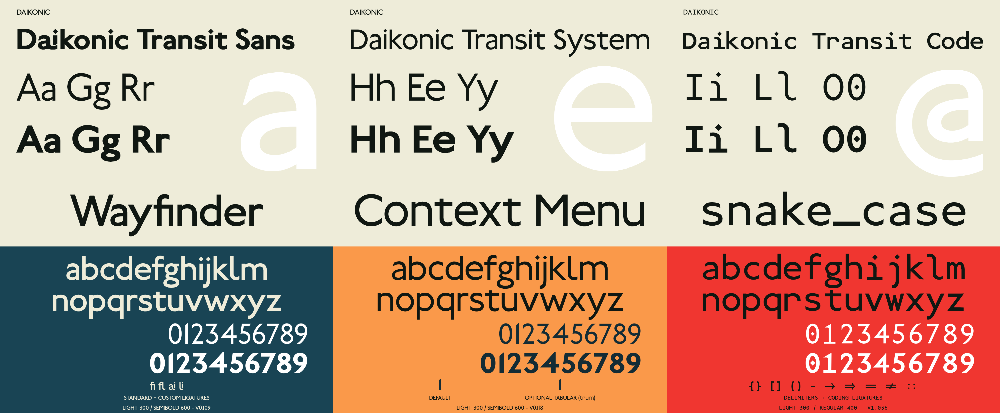

[Download the fonts](https://github.com/daikonic-org/transit-typeface/releases) · [Browse specimens](specimens/)

The current [coordinated release](https://github.com/daikonic-org/transit-typeface/releases/tag/Transit-2026.11.18.2) includes **Sans 0.109, System 0.118 and Code 1.036**. All three fonts ship together in VF, TTF, TTC, OTF, WOFF2, editable-source and specimen packages. Code includes prominent diamond dots, wider equals, joined hash rails, left-hook Rust lifetime markers, heavier structural delimiters and optional Logic enclosures.

## Daikonic Transit Sans

A proportional font for identity, headings, signage and editorial text, and the foundation of the Transit family. Based on [Metropolitan Line](https://github.com/cyrealtype/metropolitan-line), an open-source interpretation of Edward Johnston’s London Underground lettering, Sans retains its humanist character, rounded forms and distinctive diamond details while extending it into a range of weights.

- Five named weights: **Light, Book, Regular, Medium and SemiBold**, available individually or through a variable weight range of 300–600.
- Proportional spacing, kerning and accented-character positioning.
- Standard `fi` and `fl` ligatures, plus custom `ai` and `li` combinations. A curved hook beneath the `i` and a separating band of whitespace connect the forms optically. The `ai` keeps ordinary spacing; `li` uses a matching stem gap.
- Shared diamond details and the Transit arrow family.

The samples below use the actual Book font, with the listed feature enabled or disabled.

<!-- sans-features -->
| Feature / input | On | Off |
| --- | --- | --- |
| Standard ligatures <code>fi fl</code> |  | 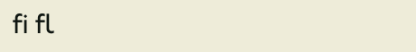 |
| Hooked combinations <code>ai li</code> |  |  |
<!-- /sans-features -->

## Daikonic Transit System

An interface font for application navigation, controls, dashboards and short passages of screen text. Developed from Daikonic Transit Sans, System combines a larger lowercase, adjusted spacing and an optical-size range for smaller interface text, while keeping Sans’s capital-height proportions.

- Five named weights: **Light, Book, Regular, Medium and SemiBold**, with a variable weight range of 300–600.
- An independent **optical-size axis, 10–36**, with Caption, Text and Display presets. It adapts the design to its intended text size without selecting a different weight.
- Proportional figures for running text and optional **tabular figures** for aligned values, tables and clocks (`pnum` / `tnum`). The tabular `1` uses Sans’s original drawing, centered in the same-width cells as the other tabular digits.
- `fi` and `fl` ligatures. `ai` and `li` remain separate letters for interface text.
- The shared diamond details and arrow family, with lowercase proportions and spacing tailored to the System design.

Tabular figures are optional (`tnum`). The default proportional `1` stays unchanged.

<!-- system-features -->
| Feature / input | On | Off |
| --- | --- | --- |
| Standard ligatures <code>fi fl</code> |  |  |
| Tabular figures <code>111  248  000</code> | 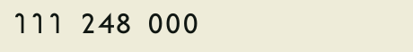 |  |
| Tabular 1 / default 1 <code>1</code> | 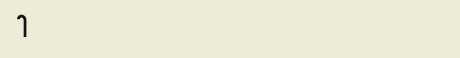 |  |
<!-- /system-features -->

## Daikonic Transit Code

A monospace font with coding-friendly glyphs, ligatures and optically adjusted proportions and spacing for source editors, terminals and code examples. Derived from Daikonic Transit Sans, Code carries its Johnston-inspired character into a fixed-width design with reworked letters, numerals, punctuation and operators for programming and aligned text.

- Three named weights: **Light, Book and Regular**, with a variable weight range of 300–400. **Book** is the default.
- Fixed-width characters and coding ligatures that occupy the same total width as their original character sequences.
- Distinct `I`, `l` and `1` forms, a diamond-dotted zero, enlarged lowercase and diamond punctuation.
- Heavier, inward-set parentheses, brackets and braces for legibility, using one weight step above the surrounding text. Contextual pipe delimiters receive the same treatment. Extended brace pinches help distinguish `{}` from `()`.
- Optical centering and contextual positioning for selected character pairs, preserving the fixed 600-unit character advance.
- Variable accent attachment and stacking (`mark` / `mkmk`), zero-width combining marks, and consistent precomposed and decomposed accented forms.
- A raised, full-width inline `_` aligned with the lowercase baseline for clearer `snake_case`, with a heavier stroke and gapless repeated underscores.
- A wider hyphen and vertically balanced operators and punctuation for inline code.
- A distinct two-storey `@` with an open, rounded wrap and contextual fitting for repeated `@` symbols.
- Arrow, comparison, scope, access, interpolation, range, assignment, turnstile, hash-group and Rust-lifetime ligatures. Contextual alternates also provide taller generic delimiters and repeated-`@` fitting. Enable font ligatures (`calt` / `liga`) in your editor; the text itself is unchanged.
- A left-hook marker for Rust lifetimes and labels (`&'a`, `<'a>`, `'static`). Contextual matching preserves character literals such as `'a'` and `'_'`.
- Optional **extended lifetime hooks (`ss01`)**, lengthening the marker’s straight stroke into the following letter’s cell, with a slight upward and inward adjustment to the marker and preceding `&` / `<`. Off by default.
- Optional **Logic (`ss02`)** enclosure ligatures: `<>`, `[]`, `<[` / `]>` and `[<` / `>]`. Joined mixed enclosures share the full bracket height. Empty nested `[<>]` renders as box then diamond (`[]<>`); `<[]>` renders as diamond then box (`<>[]`). Logic also renders prefix `!` as `¬`; inequality, optional-access punctuation, postfix/macros and simple quoted bangs retain their usual forms. Unicode `∀`, `∃` and `¬` are available directly. Off by default.
- Standard backslash shortcuts: `\forall` → `∀`, `\exists` → `∃`, `\not` → `¬`, `\box` → the closed box and `\dia` → the closed diamond. These use `calt` independently of Logic. Complete commands retain their input cell widths and internal carets, with the symbol at the right edge; direct Unicode stays one cell. Longer identifiers and doubled backslashes remain literal.
- Rust inference forms `<'_>`, `<_>` and `<[_]>` use matched generic delimiters. Turbofish `::<...>` also establishes generic context; its colon pair is optically fitted and centered beside the tall opening angle. Incomplete `::<` keeps a short angle. Underscore drawings and all character advances stay intact.
- Ligature caret positions for editors that support positioning the cursor inside a ligature.

Tall `<` and `>` appear only in matched delimiter pairs. Ordinary `<>` and `a<>b` stay short; type-name contexts such as `Vec<>` and `Vec<T>` use two tall delimiters. Nested generic pairs inherit the outer generic style (`Vec<vec<a>>`), while unmatched angles stay short (`Vec<T`, `T>`). Matching supports up to 16 nesting levels and 60 non-mark glyphs per pair, using the capital-containing identifier heuristic rather than parsing source code.

**Switchable features.** On and Off show the same text rendered in Code Book, with contextual/ligature features enabled or disabled. Each Code ligature preserves the total width of its original characters. Generic-angle fitting uses capitalized or mixed-case type names and type arguments, with up to 32 adjacent identifier glyphs for the type-name decision. Individual angles remain ordinary operators; tall forms require matched pairs. Lifetime matching uses nearby characters and protects quoted identifiers up to 32 characters; it does not parse Rust strings or comments.

<!-- code-features -->
| Feature / input | On | Off |
| --- | --- | --- |
| Forall shortcut <code>\forall</code> | 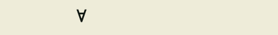 | 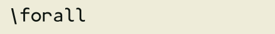 |
| Exists shortcut <code>\exists</code> | 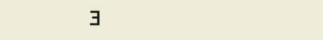 | 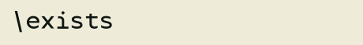 |
| Not shortcut <code>\not</code> | 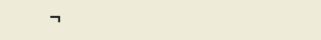 | 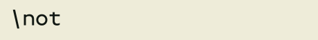 |
| Box shortcut <code>\box</code> | 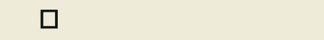 | 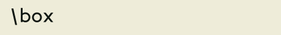 |
| Dia shortcut <code>\dia</code> | 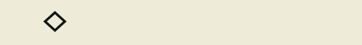 | 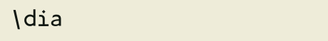 |
| Rust inference placeholders <code>&lt;&#x27;_&gt; &lt;_&gt; &lt;[_]&gt;</code> |  | 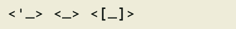 |
| Rust turbofish <code>::&lt;T&gt; ::&lt;_&gt; ::&lt;[_]&gt;</code> |  |  |
| Logical negation / ss02 <code>!p !!p != !== !.</code> | 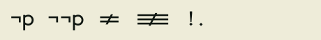 |  |
| Arrows <code>-&gt; -&gt;&gt; =&gt; &lt;- &lt;&lt;-</code> | 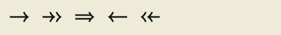 | 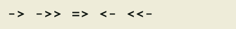 |
| Comparisons <code>== === != !== &lt;= &gt;=</code> |  |  |
| Scope separator <code>::</code> |  | 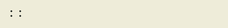 |
| Optional / non-null access <code>?. !.</code> |  | 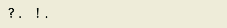 |
| Interpolation / expansion <code>${ $[ $(</code> | 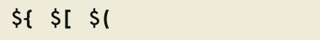 |  |
| Ranges and dot assignment <code>.. .= ..=</code> |  |  |
| Three-character ellipsis <code>...</code> |  |  |
| Assignment / turnstiles <code>:= &#124;= &#124;-</code> | 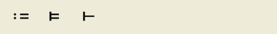 |  |
| Hash groups <code>## ### #### ##### ######</code> | 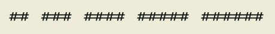 | 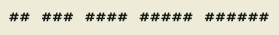 |
| Rust lifetime marker <code>&amp;&#x27;a &lt;&#x27;a&gt; &#x27;static</code> |  |  |
| Lifetimes / character literals <code>&amp;&#x27;a &#x27;a&#x27; &#x27;_&#x27;</code> | 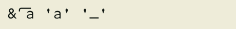 |  |
| Extended lifetime hooks / ss01 <code>&amp;&#x27;a &lt;&#x27;a&gt; &#x27;static</code> | 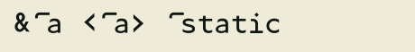 | 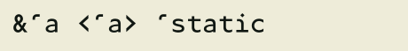 |
| Logic / ss02 <code>&lt;&gt; []</code> | 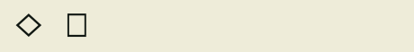 |  |
| Empty nested Logic order / ss02 <code>[&lt;&gt;] &lt;[]&gt;</code> | 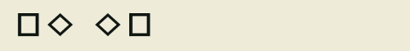 |  |
| Joined Logic enclosures / ss02 <code>&lt;[T]&gt; [&lt;T&gt;]</code> | 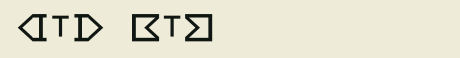 | 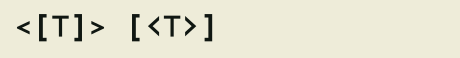 |
| Contextual pipe delimiters <code>&#124;x&#124; map(&#124;x&#124; x) a &#124; b</code> | 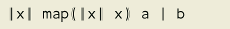 | 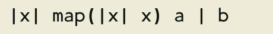 |
| Comparison / generic context <code>a&lt;&gt;b Vec&lt;&gt; Vec&lt;Vec&lt;T&gt;&gt;</code> |  |  |
| Contextual optical placement <code>ke Ke KE vi il</code> |  |  |
| Repeated at-symbol fitting <code>@@ @@@</code> |  |  |
<!-- /code-features -->

**Distinct character designs.** These are permanent parts of Code, so there is no Off setting. The samples show the current font in Book and Regular, at the same text size.

<!-- code-characters -->
| Permanent design | Book 350 | Regular 400 |
| --- | --- | --- |
| Distinct letters and figures | 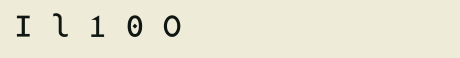 | 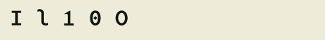 |
| Stronger, inward-set delimiters | 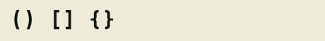 |  |
| Inline, gapless underscore | 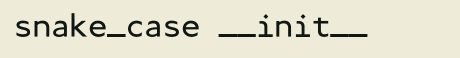 | 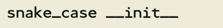 |
| Redrawn two-storey at symbol | 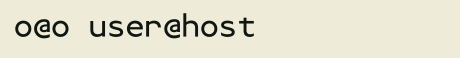 |  |
| Shared prominent diamond dots | 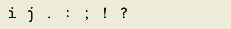 | 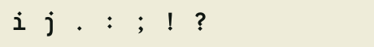 |
| Equals and hyphen | 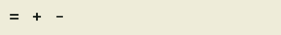 |  |
| Universal and existential quantifiers | 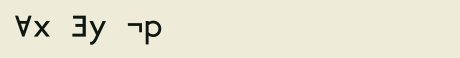 | 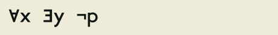 |
<!-- /code-characters -->

All three typefaces include the same family of pointed, concave arrowheads, including the Unicode arrows **← ↑ → ↓ ↔ ↕ ⇐ ⇑ ⇒ ⇓ ⇔ ⇕**.

Optical-size trials for Sans and Code add `opsz` 10–36 while preserving the existing drawings at 14. They remain separate review fonts; see [positioning, OTF and optical-size notes](docs/layout-optical.md). System retains its existing optical-size axis.

## Downloads and release packages

Each typeface has its own [release](https://github.com/daikonic-org/transit-typeface/releases) and version number. Download the package for the format you need:

| Package | Contents | Use |
| --- | --- | --- |
| **VF** | One variable TrueType font | Adjustable weights in applications that support variable fonts; System also includes optical size. |
| **TTC** | One TrueType collection per family, containing all named static styles | Install all weights together; System also includes Caption, Text and Display styles. |
| **OTF** | Static CFF OpenType fonts with the same glyphs, spacing and layout features | Desktop applications and publishing workflows that prefer CFF outlines. |
| **TTF** | Individual named-weight TrueType fonts | Applications that use separate font styles. System includes Caption, Text and Display cuts. |
| **WOFF2** | Variable webfont and a CSS example | Websites and web applications. |
| **SOURCE** | Complete editable TTX snapshots and portable rebuild scripts | Editing or building the typefaces. Historical native Glyphs/UFO/designspace sources remain in the repository at their documented versions; current TTX snapshots include every outline and layout feature. |
| **SPECIMEN** | Matching PNG, PDF and SVG specimens | Previewing and comparing the designs. |
| **SHA256SUMS** | Download checksums | Checking that an archive downloaded intact. |

Archives are named by format and coordinated release—for example, `TTC-daikonic-transit-2026.11.18.2.zip`—with separate Sans, System and Code folders inside. Font-menu names are simply **Daikonic Transit Sans**, **Daikonic Transit System** and **Daikonic Transit Code**.

Choose either the variable font, the TTC collection or the individual static styles when installing a family. The available releases contain upright styles. [Editor setup](docs/editor-setup.md) and [source/build instructions](docs/build.md) are available separately.

## Credits and tools

Daikonic Transit is a Daikonic typeface project, based on the open-source work of the **Metropolitan Line authors**. Its lineage includes **Justin Howes, Greg Fleming, Alexei Vanyashin and Michael Voronin**, and ultimately Edward Johnston’s original lettering. Original author records are preserved in [AUTHORS.txt](upstream/AUTHORS.txt) and [NOTICE.txt](NOTICE.txt).

The project uses:

- [Glyphs Mini](https://glyphsapp.com/glyphs-mini) for font editing.
- [Python](https://www.python.org/), [FontTools](https://github.com/fonttools/fonttools), [fontmake](https://github.com/googlefonts/fontmake), [glyphsLib](https://github.com/googlefonts/glyphsLib) and [ufoLib2](https://github.com/fonttools/ufoLib2) for scripted transformations, editable-source conversion and font builds.
- [Skia PathOps](https://github.com/fonttools/skia-pathops) for outline geometry, [HarfBuzz](https://github.com/harfbuzz/harfbuzz) for text shaping, and [OpenType Sanitizer](https://github.com/khaledhosny/ots) for font-file validation.
- [FreeType](https://freetype.org/), [Pillow](https://python-pillow.org/), [ReportLab](https://www.reportlab.com/), [Chromium](https://www.chromium.org/) and [Playwright](https://playwright.dev/) for proofs, comparisons and specimen exports.

Development, scripting and documentation were assisted by OpenAI ChatGPT/Codex. Additional weighting guidance was explored from Google Gemini. The format-based release layout takes inspiration from [Adobe Source Sans](https://github.com/adobe-fonts/source-sans/releases).

## License

The fonts are distributed under the [SIL Open Font License 1.1](OFL.txt). Original copyright and reserved-name notices are retained in [NOTICE.txt](NOTICE.txt).
