# Daikonic Transit

Three companion typefaces for text, interfaces and code. Daikonic Transit brings the humanist proportions and diamond details of Johnston-inspired lettering into a shared family: **Daikonic Transit Sans**, **Daikonic Transit System** and **Daikonic Transit Code**.


[Download Sans and System 1.0.0](https://github.com/daikonic-org/transit-typeface/releases/tag/Transit-1.0.0) · [Open interactive proofs](https://daikonic-org.github.io/transit-typeface/) · [Browse specimens](specimens/)

Sans and System come in upright and italic. [Download Code 1.042](https://github.com/daikonic-org/transit-typeface/releases/tag/Transit-2026.11.20).

The 9° italics use a single-storey `a`, a descending `f` and an open, single-storey `g`. Upright and italic include fitted `ff` and `tt` ligatures through `liga`. See the [italic letterforms](releases/2026.11.22/specimens/Italic-Letterforms.svg) and [paired stems](releases/2026.11.22/specimens/Paired-Stems.svg).

## Daikonic Transit Sans

A proportional font for identity, headings, signage and editorial text, and the foundation of the Transit family. Based on [Metropolitan Line](https://github.com/cyrealtype/metropolitan-line), an open-source interpretation of Edward Johnston’s London Underground lettering, Sans retains its humanist character, rounded forms and distinctive diamond details while extending it into a range of weights.

- Five named weights: **Light, Book, Regular, Medium and SemiBold**, available individually or through a variable weight range of 300–600.
- Proportional spacing, kerning and accented-character positioning.
- Standard `fi` and `fl` ligatures, plus custom `ai` and `li` combinations. A curved hook beneath the `i` and a separating band of whitespace connect the forms optically. The `ai` keeps ordinary spacing; `li` uses a matching stem gap.
- Shared diamond details and the Transit arrow family.

[Upright glyph proof](releases/1.0.0/specimens/Sans-Upright-Glyph-Proof.pdf) · [Italic glyph proof](releases/1.0.0/specimens/Sans-Italic-Glyph-Proof.pdf)

The samples below use the actual Book font, with the listed feature enabled or disabled.

<!-- sans-features -->
| Feature / input | On | Off |
| --- | --- | --- |
| Standard ligatures<br><code>fi fl</code> |  |  |
| Hooked combinations<br><code>ai li</code> | 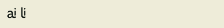 |  |
<!-- /sans-features -->

## Daikonic Transit System

An interface font for application navigation, controls, dashboards and short passages of screen text. Developed from Daikonic Transit Sans, System combines a taller lowercase relative to its capitals, adjusted spacing and an optical-size range for smaller interface text.

- Five named weights: **Light, Book, Regular, Medium and SemiBold**, with a variable weight range of 300–600.
- An independent **optical-size axis** with Caption, Text and Display presets for small labels, running text and larger interface type.
- A **width axis from 94% to 108%** with Narrow, standard and Wide presets. Width compensation keeps stroke weights close as the letters change width.
- Proportional figures for running text and optional **tabular figures** for aligned values, tables and clocks (`pnum` / `tnum`). The tabular `1` uses Sans’s original drawing, centered in the same-width cells as the other tabular digits.
- `fi` and `fl` ligatures. `ai` and `li` remain separate letters for interface text.
- The shared diamond details and arrow family, with lowercase proportions and spacing tailored to the System design.

[Upright glyph proof](releases/1.0.0/specimens/System-Upright-Glyph-Proof.pdf) · [Italic glyph proof](releases/1.0.0/specimens/System-Italic-Glyph-Proof.pdf)

<!-- system-features -->
| Feature / input | On | Off |
| --- | --- | --- |
| Standard ligatures<br><code>fi fl</code> |  |  |
| Tabular figures<br><code>111  248  000</code> |  |  |
<!-- /system-features -->

## Daikonic Transit Code

A monospace font with coding-friendly glyphs, ligatures and optically adjusted proportions and spacing for source editors, terminals and code examples. Derived from Daikonic Transit Sans, Code carries its Johnston-inspired character into a fixed-width design with reworked letters, numerals, punctuation and operators for programming and aligned text.

- Three named weights: **Book, Regular and Medium**, with a variable weight range of 350–500. **Regular** is the default. The variable width range is 94–108%.
- Fixed-width characters with [self-aligning ligatures](#self-aligning-ligatures) in upright Code.
- Recalibrated point sizing in upright and italic. **12 pt** uses approximately the previous **11.5 pt** scale.
- Distinct `I`, `l` and `1` forms, a diamond-dotted zero, enlarged lowercase and diamond punctuation.
- Heavier, inward-set parentheses, brackets and braces for legibility, using one weight step above the surrounding text. Contextual pipe delimiters receive the same treatment. Extended brace pinches help distinguish `{}` from `()`.
- Optical centering and contextual positioning for selected character pairs, preserving the fixed 600-unit character advance.
- Variable accent attachment and stacking (`mark` / `mkmk`), zero-width combining marks, and consistent precomposed and decomposed accented forms.
- A raised, full-width inline `_` aligned with the lowercase baseline for clearer `snake_case`, with a heavier stroke and gapless repeated underscores.
- A wider hyphen and vertically balanced operators and punctuation for inline code.
- A distinct two-storey `@` with an open, rounded wrap and contextual fitting for repeated `@` symbols.
- Arrow, comparison, scope, access, interpolation, range, assignment, turnstile, hash-group and Rust-lifetime ligatures. Contextual alternates also provide taller generic delimiters and repeated-`@` fitting. Enable font ligatures (`calt` / `liga`) in your editor; the text itself is unchanged.
- A left-hook marker for Rust lifetimes and labels (`&'a`, `<'a>`, `'static`). The `&` in a recognized lifetime moves slightly toward the marker. Contextual matching preserves character literals such as `'a'` and `'_'`.
- **Paired stems** (`liga`) for `ff`, `tt` and `ll` in upright and italic. The stems stay on the grid, with longer crossbars or hooks to balance the gaps. The foot of `i` aligns with the lowercase baseline.
- Optional **Logic (`ss02`)** enclosure ligatures: `<>` and `[]`. Mixed `<[` / `]>` and `[<` / `>]` remain separate, tightly fitted glyphs with tall angles, with or without Logic. Empty nested `[<>]` renders as box then diamond (`[]<>`); `<[]>` renders as diamond then box (`<>[]`). Logic also renders prefix `!` as `¬`; inequality, optional-access punctuation, postfix/macros and simple quoted bangs retain their usual forms. Unicode `∀`, `∃` and `¬` are available directly. Off by default.
- Rust inference forms `<'_>`, `<_>` and `<[_]>` use matched generic delimiters. Turbofish `::<...>` also establishes generic context; its colon pair is optically fitted and centered beside the tall opening angle. Incomplete `::<` keeps a short angle. Underscore drawings and all character advances stay intact.
- Ligature caret positions for editors that support positioning the cursor inside a ligature.

Tall `<` and `>` appear only in matched delimiter pairs. Ordinary `<>` and `a<>b` stay short; type-name contexts such as `Vec<>` and `Vec<T>` use two tall delimiters. Nested generic pairs inherit the outer generic style (`Vec<vec<a>>`), while unmatched angles stay short (`Vec<T`, `T>`), except explicit mixed square/angle enclosures, which force the tall form. Matching supports up to 16 nesting levels and 60 non-mark glyphs per pair, using the capital-containing identifier heuristic rather than parsing source code.

### Symbol shortcuts

Complete backslash commands use `calt` independently of Logic. They retain their input cell widths and internal caret positions, with the symbol at the right edge. Direct Unicode glyphs occupy one cell; longer identifiers and doubled backslashes remain literal.

<!-- code-shortcuts -->
| Input | Rendered form |
| --- | --- |
| <code>\forall</code> | 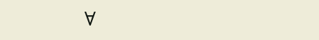 |
| <code>\exists</code> | 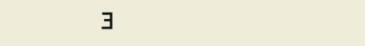 |
| <code>\not</code> | 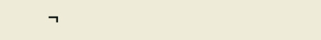 |
| <code>\box</code> | 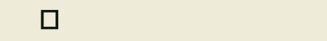 |
| <code>\diamond</code> | 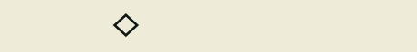 |
<!-- /code-shortcuts -->

### Ligatures and contextual features

On and Off show the same text rendered in Code Book, with contextual/ligature features enabled or disabled. Generic-angle fitting uses capitalized or mixed-case type names and type arguments, with up to 32 adjacent identifier glyphs for the type-name decision. Individual angles remain ordinary operators; tall forms require matched pairs. Lifetime matching uses nearby characters and protects quoted identifiers up to 32 characters; it does not parse Rust strings or comments.

<!-- code-features -->
| Feature / input | On | Off |
| --- | --- | --- |
| Paired stems / liga<br><code>coffee letter bell</code> | 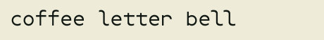 | 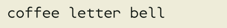 |
| Rust inference placeholders<br><code>&lt;&#x27;_&gt; &lt;_&gt; &lt;[_]&gt;</code> | 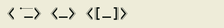 |  |
| Rust turbofish<br><code>::&lt;T&gt; ::&lt;_&gt; ::&lt;[_]&gt;</code> | 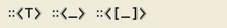 | 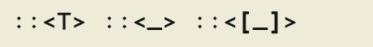 |
| Logical negation / ss02<br><code>!p !!p != !== !.</code> |  | 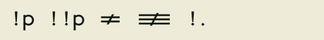 |
| Arrows<br><code>-&gt; -&gt;&gt; =&gt; &lt;- &lt;&lt;-</code> |  |  |
| Comparisons<br><code>== === != !== &lt;= &gt;=</code> |  | 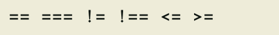 |
| Scope separator<br><code>::</code> |  |  |
| Optional / non-null access<br><code>?. !.</code> |  |  |
| Interpolation / expansion<br><code>${ $[ $(</code> |  |  |
| Ranges and dot assignment<br><code>.. .= ..=</code> |  |  |
| Three-character ellipsis<br><code>...</code> | 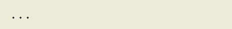 |  |
| Assignment / turnstiles<br><code>:= &#124;= &#124;-</code> |  | 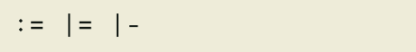 |
| Hash groups<br><code>## ### #### ##### ######</code> |  |  |
| Rust lifetime marker<br><code>&amp;&#x27;a &lt;&#x27;a&gt; &#x27;static</code> |  |  |
| Lifetimes / character literals<br><code>&amp;&#x27;a &#x27;a&#x27; &#x27;_&#x27;</code> |  |  |
| Logic / ss02<br><code>&lt;&gt; []</code> |  | 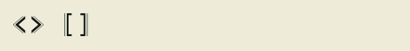 |
| Empty nested Logic order / ss02<br><code>[&lt;&gt;] &lt;[]&gt;</code> |  | 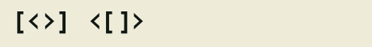 |
| Contextual pipe delimiters<br><code>&#124;x&#124; map(&#124;x&#124; x) a &#124; b</code> |  |  |
| Comparison / generic context<br><code>a&lt;&gt;b Vec&lt;&gt; Vec&lt;Vec&lt;T&gt;&gt;</code> | 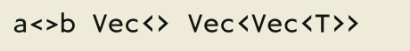 | 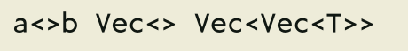 |
| Contextual optical placement<br><code>ke Ke KE vi il</code> | 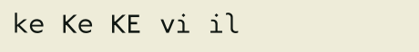 | 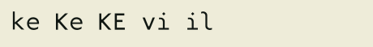 |
| Repeated at-symbol fitting<br><code>@@ @@@</code> | 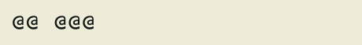 |  |
<!-- /code-features -->

### Texture healing

Upright Code uses contextual alternates to fit wider forms of `m` and `w` beside `a`, `i`, `j`, `l` and selected punctuation. Enable `ss04` to turn it off while keeping the other contextual features active. [Texture-healing specimen](releases/2026.11.19.1/specimens/Transit-Texture-Healing.svg)

<!-- code-texture-healing -->
| Feature / input | On | Off |
| --- | --- | --- |
| Texture healing<br><code>film x.m .w.</code> | 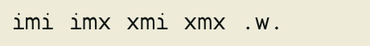 | 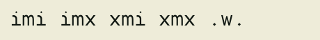 |
<!-- /code-texture-healing -->

### Hairlining

Upright Code adds 22-unit outer echoes to delimiters and a diamond with a leader over the next cell for Rust lifetimes. The outer echoes include paired pipes and tall generic angles. Hairlining is on by default. Enable `ss07` to turn it off. [Hairlining specimen](releases/2026.11.20/specimens/Code-Hairlines.svg)

<!-- code-hairlining -->
| Feature / input | On | Off |
| --- | --- | --- |
| Delimiters<br><code>&#124;w&#124; (x) [x] {x}  a &#124; b</code> | 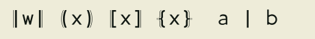 | 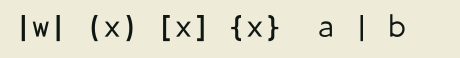 |
| Scope and generics<br><code>path::item::&lt;T&gt;</code> |  | 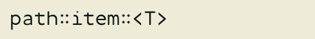 |
| Rust lifetime markers<br><code>&amp;&#x27;a &#x27;static &#x27;a&#x27;</code> | 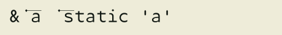 | 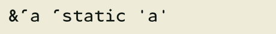 |
<!-- /code-hairlining -->

### Self-aligning ligatures

Selected ligatures in upright Code use one fewer cell and pull following text left in the same shaped run. For example, in `parse::<Vec<T>>()`, `::` takes one cell and the tall `<` starts in the next cell. The text and character order stay the same. Editors and terminals that place text on a fixed grid may retain the original source columns.

| Advance | Ligatures |
| --- | --- |
| One cell | `::`, `?.`, `!.`, `//`, logical <code>&#124;&#124;</code>, `<=`, `>=` |
| Two cells | `->`, `<-`, `->>`, `<<-`, `=>`, `==`, `!=`, `===`, `!==` |

**Loose Equality** (`ss06`, off by default) gives `==`, `!=`, `===`, and `!==` one cell each. The first two draw with a tilde above the equals bars. In `!=`, the slash crosses the bars below the tilde.

[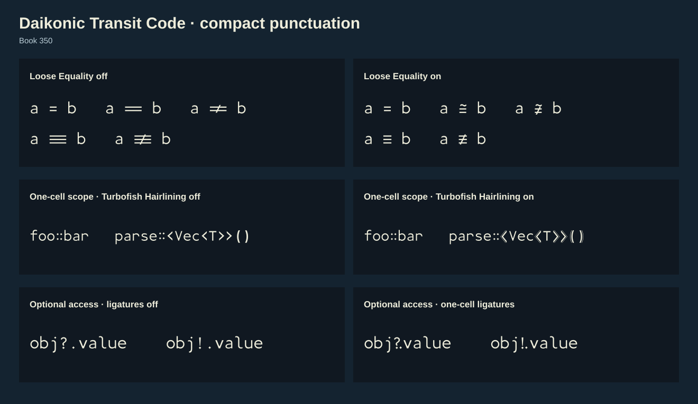](releases/2026.11.20/specimens/Compact-Punctuation.svg)

### Code example

Compare the same upright Code Book examples with features on and off. The on pane uses ligatures, contextual alternates, Texture healing, and Hairlining throughout. It enables Loose Equality only for TypeScript and Logic only for the logic example. The logic example shows how the angles and brackets in `<[p]>` and `[<q>]` sit closer together as separate glyphs. With Logic on, `[<>]` draws a box then a diamond (`[]<>`), and `<[]>` draws them in reverse order.

<!-- code-characters -->
[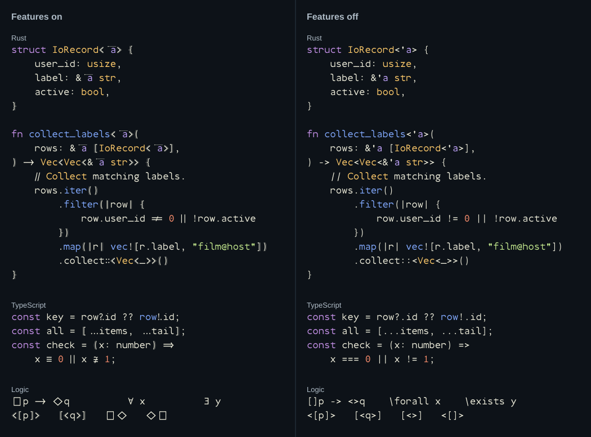](specimens/features/Code-Characters.svg)
<!-- /code-characters -->


Optical-size trials for Sans and Code add `opsz` 10–36 while preserving the existing drawings at 14. They remain separate review fonts; see [positioning, OTF and optical-size notes](docs/layout-optical.md). System retains its existing optical-size axis.

## Downloads and release packages

Each typeface has its own version number. Choose the package for the format you need from the [release page](https://github.com/daikonic-org/transit-typeface/releases).

| Package | Contents | Use |
| --- | --- | --- |
| **VF** | Variable TrueType fonts | Adjustable weights in applications that support variable fonts. System also includes width and optical size. |
| **TTC** | One TrueType collection per family, containing all named static styles | Install all weights together, including System’s width and optical-size presets. |
| **OTF** | Static CFF OpenType fonts with the same glyphs, spacing and layout features | Desktop applications and publishing workflows that prefer CFF outlines. |
| **TTF** | Individual static TrueType fonts | Applications that use separate font styles. |
| **WOFF2** | Variable webfont and a CSS example | Websites and web applications. |
| **SOURCE** | Complete editable TTX snapshots and portable rebuild scripts | Editing or building the typefaces. Historical native Glyphs/UFO/designspace sources remain in the repository at their documented versions; current TTX snapshots include every outline and layout feature. |
| **SPECIMEN** | PNG, PDF and SVG specimens, plus the interactive proof | Previewing and comparing the designs. |
| **SHA256SUMS** | Download checksums | Checking that an archive downloaded intact. |

The Sans 1.0.0 TTC contains 10 upright and italic styles. The System TTC contains 90 styles across five weights, three widths, and three optical sizes in upright and italic. Archives that ship several typefaces use a separate folder for each family. The font-menu names are **Daikonic Transit Sans**, **Daikonic Transit System** and **Daikonic Transit Code**.

Choose the variable font, the TTC collection or the individual static styles when installing a family. [Editor setup](docs/editor-setup.md) · [Source and build instructions](docs/build.md)

## Credits and tools

Daikonic Transit is a Daikonic typeface project, based on the open-source work of the **Metropolitan Line authors**. Its lineage includes **Justin Howes, Greg Fleming, Alexei Vanyashin and Michael Voronin**, and ultimately Edward Johnston’s original lettering. Original author records are preserved in [AUTHORS.txt](upstream/AUTHORS.txt) and [NOTICE.txt](NOTICE.txt).

The project uses:

- [Glyphs Mini](https://glyphsapp.com/glyphs-mini) for font editing.
- [Python](https://www.python.org/), [FontTools](https://github.com/fonttools/fonttools), [fontmake](https://github.com/googlefonts/fontmake), [glyphsLib](https://github.com/googlefonts/glyphsLib) and [ufoLib2](https://github.com/fonttools/ufoLib2) for scripted transformations, editable-source conversion and font builds.
- [Skia PathOps](https://github.com/fonttools/skia-pathops) for outline geometry, [HarfBuzz](https://github.com/harfbuzz/harfbuzz) for text shaping, and [OpenType Sanitizer](https://github.com/khaledhosny/ots) for font-file validation.
- [FreeType](https://freetype.org/), [Pillow](https://python-pillow.org/), [ReportLab](https://www.reportlab.com/), [Chromium](https://www.chromium.org/) and [Playwright](https://playwright.dev/) for proofs, comparisons and specimen exports.

Development, scripting and documentation were assisted by OpenAI ChatGPT/Codex. Additional weighting guidance was explored from Google Gemini. The format-based release layout takes inspiration from [Adobe Source Sans](https://github.com/adobe-fonts/source-sans/releases).

## License

The fonts are distributed under the [SIL Open Font License 1.1](OFL.txt). Original copyright and reserved-name notices are retained in [NOTICE.txt](NOTICE.txt).

## Code editor setup

Install **Daikonic Transit Code** from the VF or TTC package. In VS Code, open **Preferences: Open User Settings (JSON)** from the Command Palette and merge these settings for Book with coding ligatures enabled.

```json
{
  "editor.fontFamily": "'Daikonic Transit Code', monospace",
  "editor.fontWeight": "350",
  "editor.fontVariations": true,
  "editor.fontLigatures": true
}
```

### Width on macOS

Install the Code variable TTFs in Font Book to choose any width from 94% to 108%. In VS Code, set `editor.fontVariations` to `"'wght' 350, 'wdth' 94"` for Narrow Book. Use `400` for Regular or `500` for Medium. [Font Book installation](https://support.apple.com/guide/font-book/welcome/mac) · [VS Code variation settings](https://code.visualstudio.com/updates/v1_74#_new-font-setting-for-opentype-fonts)

The Code TTC includes Book, Regular, and Medium in Narrow (94%), standard (100%), and Wide (108%), with matching italics. Choose **Daikonic Transit Code** in a font picker and select a style such as **Book Narrow** or **Regular Wide**. [WezTerm and Zed setup](docs/editor-setup.md)

Choose the System variable TTFs to adjust width continuously, or use the TTC for named Narrow and Wide styles at each weight and optical size. [System width downloads](https://github.com/daikonic-org/transit-typeface/releases/tag/Transit-1.0.0)
