# Daikonic Transit

Three companion typefaces for text, interfaces and code. Daikonic Transit brings the humanist proportions and diamond details of Johnston-inspired lettering into a shared family: **Daikonic Transit Sans**, **Daikonic Transit System** and **Daikonic Transit Code**.

[Download the fonts](https://github.com/daikonic-org/transit-typeface/releases) · [Browse specimens](specimens/)

The current [Code 1.026 preview](previews/code-1.026/) includes consistent prominent diamond dots, wider equals, additional coding ligatures and taller generic delimiters. The approved `?.` and `!.` use their original internal spacing; `?.` has a small rightward optical shift. [Preview packages](https://github.com/daikonic-org/transit-typeface/releases/tag/Code-1.026-preview) separate VF, OTF, TTF, WOFF2, editable TTX sources and specimens. Earlier cuts and stable releases remain available.

## Daikonic Transit Sans

A proportional font for identity, headings, signage and editorial text, and the foundation of the Transit family. Based on [Metropolitan Line](https://github.com/cyrealtype/metropolitan-line), an open-source interpretation of Edward Johnston’s London Underground lettering, Sans retains its humanist character, rounded forms and distinctive diamond details while extending it into a range of weights.

- Five named weights: **Light, Book, Regular, Medium and SemiBold**, available individually or through a variable weight range of 300–600.
- Proportional spacing, kerning and accented-character positioning.
- Standard `fi` and `fl` ligatures, plus custom `ai` and `li` combinations. A curved hook beneath the `i` and a separating band of whitespace connect the forms optically. The `ai` keeps ordinary spacing; `li` uses a matching stem gap.
- Shared diamond details and the Transit arrow family.

The samples below use the actual Book font, with the listed feature enabled or disabled.

<!-- sans-features -->
| Feature / input | On | Off |
| --- | --- | --- |
| Standard ligatures <code>fi fl</code> | 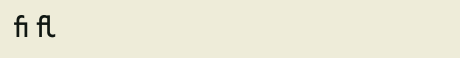 |  |
| Hooked combinations <code>ai li</code> |  | 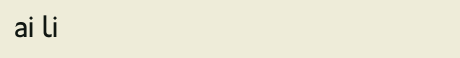 |
<!-- /sans-features -->

## Daikonic Transit System

An interface font for application navigation, controls, dashboards and short passages of screen text. Developed from Daikonic Transit Sans, System combines a larger lowercase, adjusted spacing and an optical-size range for smaller interface text, while keeping Sans’s capital-height proportions.

- Five named weights: **Light, Book, Regular, Medium and SemiBold**, with a variable weight range of 300–600.
- An independent **optical-size axis, 10–36**, with Caption, Text and Display presets. It adapts the design to its intended text size without selecting a different weight.
- Proportional figures for running text and optional **tabular figures** for aligned values, tables and clocks (`pnum` / `tnum`). The tabular `1` has a curved hook and no pedestal.
- `fi` and `fl` ligatures. `ai` and `li` remain separate letters for interface text.
- The shared diamond details and arrow family, with lowercase proportions and spacing tailored to the System design.

Tabular figures are optional; the hooked `1` appears with `tnum`. The default proportional `1` stays unchanged.

<!-- system-features -->
| Feature / input | On | Off |
| --- | --- | --- |
| Standard ligatures <code>fi fl</code> | 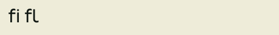 |  |
| Tabular figures <code>111  248  000</code> |  | 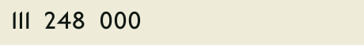 |
| Tabular 1 / default 1 <code>1</code> |  | 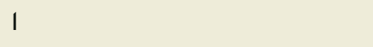 |
<!-- /system-features -->

## Daikonic Transit Code

A monospace font with coding-friendly glyphs, ligatures and optically adjusted proportions and spacing for source editors, terminals and code examples. Derived from Daikonic Transit Sans, Code carries its Johnston-inspired character into a fixed-width design with reworked letters, numerals, punctuation and operators for programming and aligned text.

- Three named weights: **Light, Book and Regular**, with a variable weight range of 300–400. **Book** is the default.
- Fixed-width characters and coding ligatures that occupy the same total width as their original character sequences.
- Distinct `I`, `l` and `1` forms, a diamond-dotted zero, enlarged lowercase and diamond punctuation.
- Heavier, inward-set parentheses, brackets and braces for legibility. Extended brace pinches help distinguish `{}` from `()`.
- Optical centering and contextual positioning for selected character pairs, preserving the fixed 600-unit character advance.
- Variable accent attachment and stacking (`mark` / `mkmk`), zero-width combining marks, and consistent precomposed and decomposed accented forms.
- A raised, full-width inline `_` aligned with the lowercase baseline for clearer `snake_case`, with a heavier stroke and gapless repeated underscores.
- A wider hyphen and vertically balanced operators and punctuation for inline code.
- A distinct two-storey `@` with an open, rounded wrap and contextual fitting for repeated `@` symbols.
- Arrow, comparison, scope, access, interpolation, range, assignment, turnstile, hash-group and Rust-lifetime ligatures. Contextual alternates also provide taller generic delimiters and repeated-`@` fitting. Enable font ligatures (`calt` / `liga`) in your editor; the text itself is unchanged.
- A diamond-headed, tapered apostrophe for Rust lifetimes and labels (`&'a`, `<'a>`, `'static`), with a flat terminal above the x-height. Contextual matching preserves character literals such as `'a'` and `'_'`.
- Ligature caret positions for editors that support positioning the cursor inside a ligature.

**Switchable features.** On and Off show the same text rendered in Code Book, with contextual/ligature features enabled or disabled. Each Code ligature preserves the total width of its original characters. Generic-angle fitting is a typographic heuristic: `<` is tall by default, but short with whitespace on both sides or between lowercase/numeric operands (`a<b`, `x<2`, `12<34`). Capitalized or mixed-case adjacent words keep tall generic forms (`Vec<T>`, `Vec<u8>`), using up to 32 surrounding glyphs. Lifetime matching uses nearby characters and protects quoted identifiers up to 32 characters; it does not parse Rust strings or comments.

<!-- code-features -->
| Feature / input | On | Off |
| --- | --- | --- |
| Arrows <code>-&gt; -&gt;&gt; =&gt; &lt;- &lt;&lt;-</code> |  |  |
| Comparisons <code>== === != !== &lt;= &gt;=</code> | 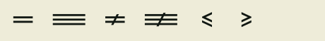 |  |
| Scope separator <code>::</code> | 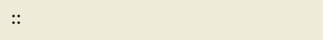 |  |
| Optional / non-null access <code>?. !.</code> | 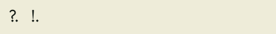 |  |
| Interpolation / expansion <code>${ $[ $(</code> |  | 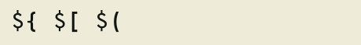 |
| Ranges and dot assignment <code>.. .= ..=</code> | 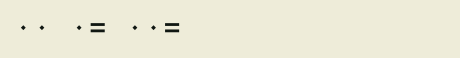 | 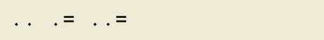 |
| Three-character ellipsis <code>...</code> |  | 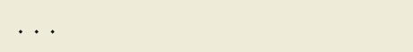 |
| Assignment / turnstiles <code>:= &#124;= &#124;-</code> |  |  |
| Hash groups <code>## ### ####</code> |  |  |
| Rust lifetime marker <code>&amp;&#x27;a &lt;&#x27;a&gt; &#x27;static</code> | 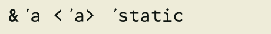 | 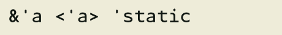 |
| Lifetimes / character literals <code>&amp;&#x27;a &#x27;a&#x27; &#x27;_&#x27;</code> |  | 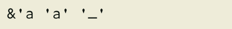 |
| Comparison / generic context <code>a&lt;b x&lt;2 Vec&lt;T&gt; Vec&lt;u8&gt;</code> |  |  |
| Contextual optical placement <code>ke Ke KE vi il</code> |  |  |
| Repeated at-symbol fitting <code>@@ @@@</code> |  | 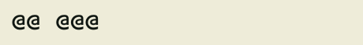 |
<!-- /code-features -->

**Distinct character designs.** These are permanent parts of Code, so there is no Off setting. The comparison uses Code Book and the original Metropolitan Line Regular at the same text size; the base font is proportional.

<!-- code-characters -->
| Permanent design | Transit Code | Metropolitan Line reference |
| --- | --- | --- |
| Distinct letters and figures | 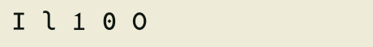 | 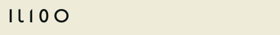 |
| Stronger, inward-set delimiters | 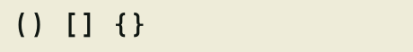 | 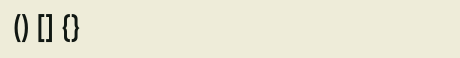 |
| Inline, gapless underscore | 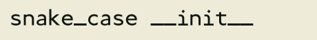 | 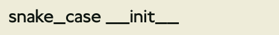 |
| Redrawn two-storey at symbol | 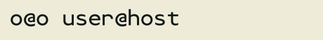 | 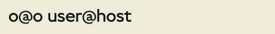 |
| Shared prominent diamond dots | 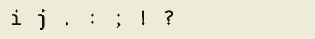 | 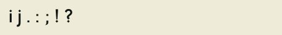 |
| Equals and hyphen | 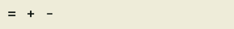 | 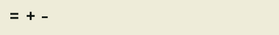 |
<!-- /code-characters -->

**Equals width, at matching weights.** The equals was widened horizontally, not emboldened. Comparing Code with the previous Code cut isolates the change: Regular goes from 438 to 474 units wide (about 8%), while its 101-unit bar thickness stays the same. Book goes from 420 to 454 units, retaining its 89-unit bars. Metropolitan Line Regular has 100-unit bars, so comparing it with Code Book mixes a width change with a lighter weight.

<!-- code-equals -->
| Matching Code weight | Current Code 1.026 | Previous Code 1.023 |
| --- | --- | --- |
| Book 350 | 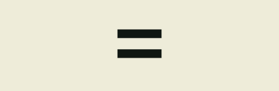 |  |
| Regular 400 | 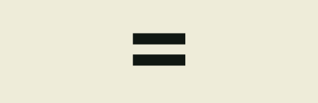 |  |
<!-- /code-equals -->

All three typefaces include the same family of pointed, concave arrowheads, including the Unicode arrows **← ↑ → ↓ ↔ ↕ ⇐ ⇑ ⇒ ⇓ ⇔ ⇕**.

Optical-size trials for Sans and Code add `opsz` 10–36 while preserving the existing drawings at 14. They remain separate review fonts; see [positioning, OTF and optical-size notes](docs/layout-optical.md). System retains its existing optical-size axis.

## Downloads and release packages

Each typeface has its own [release](https://github.com/daikonic-org/transit-typeface/releases) and version number. Download the package for the format you need:

| Package | Contents | Use |
| --- | --- | --- |
| **VF** | One variable TrueType font | Adjustable weights in applications that support variable fonts; System also includes optical size. |
| **OTF** | Static CFF OpenType fonts with the same glyphs, spacing and layout features | Desktop applications and publishing workflows that prefer CFF outlines. |
| **TTF** | Individual named-weight TrueType fonts | Applications that use separate font styles. System includes Caption, Text and Display cuts. |
| **WOFF2** | Variable webfont and a CSS example | Websites and web applications. |
| **SOURCE** | Editable Glyphs and UFO sources, designspaces and rebuild inputs | Editing or building the typefaces. System’s large Glyphs file is supplied inside a ZIP. Code previews instead include a complete editable TTX font snapshot and portable rebuild script; native Glyphs/UFO sources retain their separately documented version. |
| **SPECIMEN** | Matching PNG, PDF and SVG specimens | Previewing and comparing the designs. |
| **SHA256SUMS** | Download checksums | Checking that an archive downloaded intact. |

Archives are named by format, family and version—for example, `VF-daikonic-transit-code-1.017R.zip`. Font-menu names are simply **Daikonic Transit Sans**, **Daikonic Transit System** and **Daikonic Transit Code**.

Choose either the variable font or the individual static styles when installing a family. The available releases contain upright styles. [Editor setup](docs/editor-setup.md) and [source/build instructions](docs/build.md) are available separately.

## Credits and tools

Daikonic Transit is a Daikonic typeface project, based on the open-source work of the **Metropolitan Line authors**. Its lineage includes **Justin Howes, Greg Fleming, Alexei Vanyashin and Michael Voronin**, and ultimately Edward Johnston’s original lettering. Original author records are preserved in [AUTHORS.txt](upstream/AUTHORS.txt) and [NOTICE.txt](NOTICE.txt).

The project uses:

- [Glyphs Mini](https://glyphsapp.com/glyphs-mini) for font editing.
- [Python](https://www.python.org/), [FontTools](https://github.com/fonttools/fonttools), [fontmake](https://github.com/googlefonts/fontmake), [glyphsLib](https://github.com/googlefonts/glyphsLib) and [ufoLib2](https://github.com/fonttools/ufoLib2) for scripted transformations, editable-source conversion and font builds.
- [Skia PathOps](https://github.com/fonttools/skia-pathops) for outline geometry, [HarfBuzz](https://github.com/harfbuzz/harfbuzz) for text shaping, and [OpenType Sanitizer](https://github.com/khaledhosny/ots) for font-file validation.
- [FreeType](https://freetype.org/), [Pillow](https://python-pillow.org/), [ReportLab](https://www.reportlab.com/), [Chromium](https://www.chromium.org/) and [Playwright](https://playwright.dev/) for proofs, comparisons and specimen exports.

Development, scripting and documentation were assisted by OpenAI ChatGPT/Codex. Additional weighting guidance was explored from Google Gemini. The format-based release layout takes inspiration from [Adobe Source Sans](https://github.com/adobe-fonts/source-sans/releases).

## License

The fonts are distributed under the [SIL Open Font License 1.1](OFL.txt). Original copyright and reserved-name notices are retained in [NOTICE.txt](NOTICE.txt).
