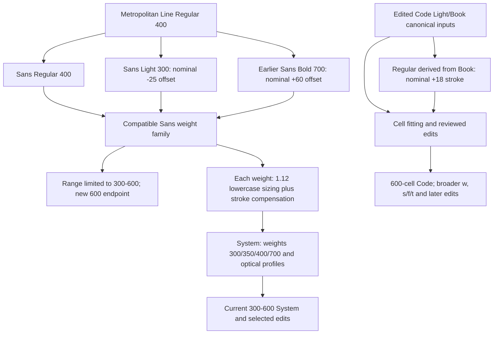
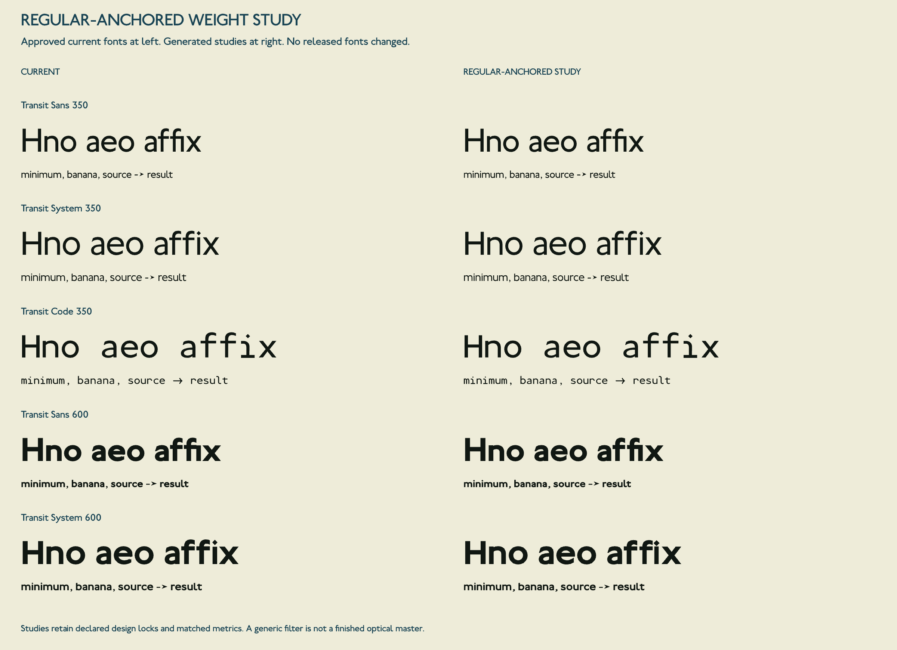

# Scaling, weight lineage and scriptable generation

This deeper review answers the concern that Light/Book may have been reduced from Regular and subsequently enlarged or emboldened back into Regular. It separates verified dependencies, measured current outlines, and new controlled studies. No approved font binaries were changed.

## What actually depended on what



**Sans:** the preserved original Regular was the reference. Light and the earlier Bold were derived around it. Current600 came from limiting/interpolating the earlier variable family, not by stretching a light outline back to Regular. Sans Regular retains the original `H`, `x` and `n` size profile.

**System:** `build_sans_ui_trial.py` iterated the Sans Light, Regular and earlier Bold masters. For each, it enlarged lowercase geometry by 1.12 in both dimensions and applied a negative stroke correction based on that master’s `n` stem. `build_system_family.py` then sampled300,350,400,700 for each optical profile. **Book 350 is the default location, not the drawing from which System Regular 400 was enlarged.** Later stages adjusted spacing, ascenders, marks, punctuation and selected glyphs.

**Code:** its preserved edited Light/Book drawings already include earlier monospacing and manual changes. `build_cell_trials.raw_masters()` copied the Book drawing and generated Regular through `heavier_glyph()` with nominal 18-unit stroke growth, with reductions for topology failures. Further fitting and optical edits followed. This is a real chained Book→Regular step. The initial pre-v1.000 conversion cannot be fully replayed from the currently preserved scripts alone; the edited source drawings are the explicit boundary, rather than an invented precise upstream scale factor.

Historical scripts in the original development workspace supplied the dependency evidence. Current geometry and the controlled probes below are reproducible from this repository. Current editable Glyphs/UFO and compatible TTF masters are complete design inputs, even where a prior manual edit cannot be represented as a single numeric recipe.

## Measured size and weight

All values are font units at 1000 UPM and Regular 400; System uses opsz14.

| Control | Metropolitan Regular / Sans Regular | System Regular | Code Regular |
| --- | ---: | ---: | ---: |
| `H` ink y-range |0–700 |0–700 |12–688 |
| `x` ink y-range |0–475 |0–532 |12–518 |
| `n` ink y-range, including shoulder overshoot |0–485 |0–543 |13–528 |
| `H` vertical stem |110 |110 |120 |
| Declared x-height |475 |532 |530 |
| Declared cap height |700 |700 |700 |

System’s flat x-height532 is exactly475×1.12, while its capital `H` stays700 high. That matches the intended lowercase-only sizing. Code has a different inherited ink profile, with a slightly raised/shrunken capital silhouette and larger lowercase relative to it. Its current Regular `H` is about 9.1% heavier than Sans/System Regular, while Code Book is102, much closer to their110-unit Regular than Code120 is. Weight numbers are design labels; this is a calibration difference to review, not an automatic font-format error.

The Code 600-cell change did **not** scale every glyph upward. `build_600_family.py` changed advances and translated existing outlines to the new cell, widening the `w` group separately. A larger cell, larger lowercase, and heavier stroke are three independent transformations and should remain separate parameters.

## What the controlled studies show

[`scaling-study.json`](scaling-study.json) compares weighting-before-sizing with sizing-before-weighting on the same original Regular controls, using the same 1.12 factor and topology-preserving offset rules. The largest coverage difference in the tested `n/o/a/e/s` cases is about 8%. This includes branch changes where counter preservation forces a smaller offset. It is evidence that the operations are not interchangeable, **not proof that the current System drawings suffered8% damage**.

[`weight-study-approved-regular-ratio-1.json`](weight-study-approved-regular-ratio-1.json) creates weights directly from each family’s declared Regular 400 drawing, with matched current metrics and explicit selected-glyph locks. It does not chain a new Regular through Light/Book. A controlled−25/+25 round trip on `H/n/o/a/e/s` changes rendered coverage by roughly 0.1–1.2% in these controls. Small differences remain even when stem width returns, so repeated morphology is not a lossless editing operation.

At matched target `H` stem150, the supplied 0.72 ratio is not equivalent to an effective72% crossbar-growth ratio after height refitting:

| Sans600 control | `H` vertical | `H` crossbar | `o` counter area |
| --- | ---: | ---: | ---: |
| Current approved font |150 |132 |48,490.17 |
| Regular-anchored study, ratio 1 |150 |133 |47,968.50 |
| Regular-anchored study, ratio0.72 |150 |123 |50,857.33 |

The 0.72 setting gives lighter horizontals and roughly5% more `o` counter area than the current design at the same vertical stem. It may be a useful candidate, but it would visibly change the family. Its effective crossbar growth from 100 is23/40=57.5%, because the later height-fit step also acts on the result. Do not import0.72 as a universal optical rule.

The new generic Regular-anchored600 studies require topology backoffs on dozens of glyphs (for example,83 in Sans at ratio 1). A generic offset is therefore not a polished weight master, even if its `H` hits the intended measurement. This supports retaining reviewed per-glyph corrections and making their exceptions explicit.



## Executable recipe

The transformations were already Python; they were spread across version-specific scripts and frozen editing checkpoints. The repository now makes two routes explicit:

```sh
# Reconstruct approved releases exactly from their compatible master drawings.
python tools/pipeline.py approved

# Generate independent weights from canonical Regular 400, all three families.
python tools/pipeline.py study --family all

# Try more horizontal compensation without replacing the approved fonts.
python tools/pipeline.py study --family sans --ratio-y 0.72

# Isolate a fresh upstream Regular-based Sans baseline, without drawing locks.
python tools/derive_weights.py sans --source upstream-regular

# Recompute size/weight-order and stroke-preserving width probes.
python tools/pipeline.py report
```

[`recipes/weights.json`](../recipes/weights.json) declares the anchor, target stem weights, optical profiles, offset ratio, topology policy, metric policy and selected drawing locks. It also records historical geometry parameters rather than hiding them in prose. `tools/derive_weights.py` applies the shared weight operation; `tools/scaling_study.py` exposes lowercase enlargement and stroke-preserving width fitting as executable functions. The width control shows that naive577→528 compression thins a110-unit `H` stem to100.66, while the compensated fit keeps110.

Generated studies live under `.build/weight-studies/`, use distinct Study family names, pass OTS and are **not release assets**. Their reports record source hashes, actual glyph offsets and every reduced-offset fallback. At zero offset, the Regular outlines are retained exactly. Locks preserve selected numeral/narrow-letter/arrow/ligature drawings from the approved target weight; those are explicit authored overrides, not claimed products of a generic filter. Metrics/layout tables are matched to the approved instance so comparison does not conflate weight generation with a new spacing scheme.

Current release rebuilding remains independent: compatible master→VF→named snapshots. The new weight generator is a controlled source-design alternative, not a retrospective claim that every manual source can be regenerated from Metropolitan Regular alone.

## Recommendation

Keep the accepted releases as the reference. For the next design iteration, compare a deliberately approved Regular anchor for each family, a controlled anisotropic600 master for Sans/System, and a separately calibrated Code Regular against Book 350. Review counters, `e` apertures, hooks, uppercase/lowercase size relationships and14px text. Do not discard the reviewed `i/l/j`, `g`, `1`, `y`, punctuation and arrow work to obtain a cleaner-looking automation story.
