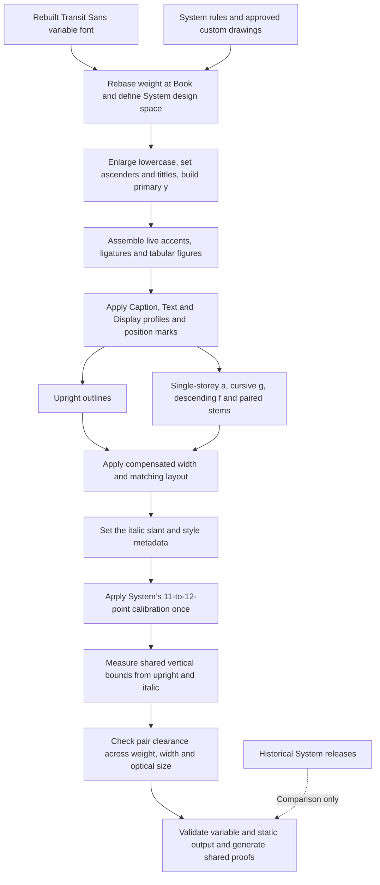

# Daikonic Transit System rebuild

**Build input.** The rebuilt Daikonic Transit Sans variable TTF is the sole font input. System is the result of applying the rules below to Sans. Keep the approved custom drawings and transformation settings small and explicit. A historical System release can be opened during review to check an approved measurement or behavior. The builder requires no historical System binary, source file, outline, variation table, or shaping table.

Use the shared [glyph proof](build.md#glyph-proofs) after each design step. Commit the builder and proof evidence together. Earlier System trial commits are design and validation history. Re-run their checks on the Sans-derived output before counting any step as complete.

## Build flow



The calibration can run earlier in the implementation if later operations use the calibrated optical coordinates consistently. At the font boundary, the Sans source uses 1000 units per em and System uses 1091. Apply the 12/11 factor once to the units per em and optical coordinate labels. Layout features and design coordinates use the same font units as before.

## Task list

| Step | Work | Completion evidence |
| --- | --- | --- |
| 1. Sans-derived foundation | Build from one Sans TTF. Preserve compatible source curves and reusable components. Rebase the weight axis at Book 350 within 300–600. Define Caption, Text, and Display from the approved 10, 14, and 36 profiles. | A build from a clean checkout with just the Sans input succeeds. The source file hash and axis defaults appear in the build report. |
| 2. Lowercase and custom forms | Apply the shared 112% lowercase transformation and stroke compensation. Return `b d h k l` to 700, `t` to 610, and `f` to 730. Keep the released System descender depths and the primary `y` hook. Keep the diamond tittles at 720 through Regular, rising to 742 at SemiBold. Inherit dedicated drawings such as `ť` from Sans. | Measure the outlines at named and intermediate locations and review the shared lowercase proof. |
| 3. Components and marks | Reuse compatible Sans recipes for accents, including `y` derivatives. Retain separate marks and intended joins. Position combining marks, including the reflected attachment for `b`. Keep System’s `fi`, `fl`, `ff`, and `tt` behavior and omit the `ai` and `li` substitutions. | Precomposed and decomposed text shape consistently. Mark and ligature placements are tested at named and intermediate locations. |
| 4. Tabular grid | Keep proportional figures by default. Build the ten `tnum` digits and three half-cell separators as live components. Center the approved Sans `1` in the tabular cell and center the tabular colon on the cap-height midpoint. | The variable and static fonts agree on digit and separator advances. `pnum` restores proportional variants. |
| 5. Optical size and calibration | Apply the established Caption/Text/Display spacing and diamond profiles. Include the reviewed increase through optical size 12 and taper it to zero at Text. Carry the 11-to-12-point calibration as an explicit System step derived from Sans. | Verify calibrated `fvar` and `STAT` coordinates, rendered size, zero-advance marks, and half-grid consistency across the optical interval. |
| 6. Width | Carry the 94–108 range with a 100 default. Preserve the normal-width drawings and compensate horizontal stem weight. Scale advances, kerning, carets, and anchors coherently. | Narrow, Normal, and Wide proofs, with endpoint and intermediate measurements across weight and optical size. Confirm the named width instances and static metrics. |
| 7. Italic | Derive the 9° italic from the rebuilt System geometry. Use the live single-storey `a`, cursive `g`, descending `f` and shared ligature parts. Preserve width behavior, upright diamond tittles, and tabular alignment. | The same inventory and axes ship in both styles. Check outlines, slopes, accents, joint geometry and variable/static advances on the compiled fonts. |
| 8. Final review | Derive shared vertical metrics from both faces. Run collision repair, check the reviewed near-contact pairs, and generate the glyph proofs. | Verify the recorded vertical bounds and pair clearances, inspect the proofs, and validate the installable files. |

The earlier figure, mark, optical, width and italic work supplies tested algorithms and comparison values. Its results need to be reproduced on the Sans-only build. Complete those steps in this order unless a shared dependency requires an earlier implementation.

## Working references and progress

The earlier System family was derived from Sans. The current working references are the Primary Y review, the Caption Spacing review, and the System Width Trial including its italic. They record the approved design decisions. The Primary Y review binary carries the calibrated optical axis and proportional/tabular forms. The Width Trial carries the Narrow and Wide range in both styles. Preserve these decisions while reinstating their generation rules on the rebuilt Sans.

The Sans-only builder produces review TTFs for both styles and their browser proofs. It measures the top and bottom of the drawn glyphs at the masters and adds the established 12-unit safety margin. Both faces share the resulting native and Windows metrics. The source hash, axes, and measured vertical bounds are recorded in `build.json`.

After collision repair, the builder checks the six upright and ten italic pairs in the
[System spacing recipe](../recipes/system-pair-spacing.json). For a measured gap below one
font unit, it adds variable kerning in whole units to reach at least four. The pass samples
weight every 12.5 units and uses the existing width and optical-size grid. The
`near_contact` entry in each `.kerning.json` records the sample count and pair corrections.

```sh
python tools/build_system.py releases/2026.11.22/sans/VF/DaikonicTransitSans-VF.ttf .build/system-from-sans
```

Pass `--outline-only` for a drawing and metrics review before kerning.

The integrated review uses the shared lowercase pages for both faces. [Upright proof](../trials/2026-11-23-system-rebuild/System-Sans-Derived-Lowercase.svg) · [Italic proof](../trials/2026-11-23-system-rebuild/System-Sans-Derived-Italic-Lowercase.svg) · [Build report](../trials/2026-11-23-system-rebuild/Sans-Derived-Build.json)
