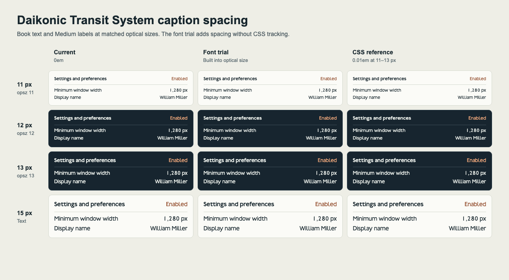

# Daikonic Transit System Caption Spacing

This trial adds about `0.01em` of advance at Caption and through optical size 12 in upright and italic System. The increase tapers to zero at the Text preset (15.27). Outlines, the shaping tables, and zero-width mark advances are preserved. The tabular `1` also gets the same advance variation as the other tabular digits when generating static instances.



[Open the browser comparison](Caption-Spacing.html). The comparison uses the same optical size, weight, and text in each row.

## Rebuild

The build starts from the released System 0.120 variable fonts. Run this command from the repository root.

```sh
python tools/system_caption_spacing.py trials/2026-11-19-system-caption-spacing
```

The script builds the two TTFs and WOFF2s. It checks optical-size and weight interpolation, static-instance metrics, and tabular figures, then runs OpenType Sanitizer on both TTFs.
